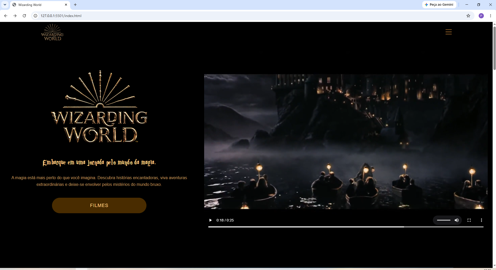

# ⚡ Wizarding World


[English](#english) | [Português](#português)

🔗 **Live Demo:** https://wizardingworld-liard.vercel.app/
---

## Disclaimer | Aviso Legal

This is an unofficial, non-commercial educational project. All rights to the original franchises, characters, images, videos, trademarks, and related materials belong to their respective copyright holders.

Este é um projeto educacional, não oficial e sem fins comerciais. Todos os direitos sobre as franquias, personagens, imagens, vídeos, marcas e materiais relacionados pertencem aos seus respectivos titulares.

## Project Preview | Demonstração

### Desktop



### Mobile


---

## English

### About the Project

Wizarding World is a responsive, interactive website inspired by the Harry Potter and Fantastic Beasts franchises.

Developed as part of the Front-End Engineering course at EBAC, this project combines a cinematic visual experience with responsive design, interactive components, accessibility improvements, and automated asset optimization.

The theme and visual identity were independently selected and developed for this project.

### Features

- Responsive layout for desktop, tablet, and mobile devices.
- Cinematic video introduction.
- Interactive navigation.
- Harry Potter and Fantastic Beasts movie catalogs.
- External links to movie trailers.
- Dynamic character tabs.
- Interactive horizontal character carousels.
- Frequently Asked Questions (FAQ).
- Custom typography.
- Accessibility attributes for interactive elements.
- SEO metadata.
- Automated asset compression and minification.

### Technologies and Tools

| Technology | Purpose |
|---|---|
| HTML5 | Page structure |
| CSS3 / SCSS | Styling and responsive layouts |
| JavaScript | Interactivity and DOM manipulation |
| Gulp | Task automation |
| Sass | CSS preprocessing and compression |
| Gulp Uglify | JavaScript minification |
| Gulp Imagemin | Image optimization |
| FFmpeg | Video compression and web optimization |
| Node.js | Development environment |
| npm | Dependency management |
| Git and GitHub | Version control |
| Vercel | Deployment |
| Lighthouse | Website auditing |

### Performance and Quality

The project was evaluated using Google Lighthouse in a local development environment.

| Metric | Desktop | Mobile |
|---|---:|---:|
| Performance | 94 | 73.5 |
| Accessibility | 92 | 92 |
| Best Practices | 96 | 96 |
| SEO | 100 | 100 |

The scores represent the average of two recent local audits for each device category. Results may vary depending on network conditions, hardware, browser activity, and the deployment environment.

### Asset Optimization

The automated build workflow includes:

- SCSS compilation into compressed CSS.
- JavaScript minification.
- Image compression.
- MP4 video compression using the H.264 codec.
- Fast-start video configuration for web playback.
- Automatic monitoring of SCSS and JavaScript changes.

### Project Structure

```text
wizarding_world/
├── src/
│   ├── images/
│   ├── scripts/
│   ├── styles/
│   └── video/
├── dist/
│   ├── css/
│   ├── images/
│   ├── js/
│   └── video/
├── index.html
├── gulpfile.js
├── package.json
├── package-lock.json
└── README.md
```

Main directories and configuration files.

### Installation and Usage

Clone the repository:

```bash
git clone -b projeto4_wizarding https://github.com/p1Helena/wizarding_world.git
```

Access the project directory:

```bash
cd wizarding_world
```

Install dependencies:

```bash
npm install
```

Generate all optimized assets:

```bash
npm run build:full
```

Open `index.html` using a local development server, such as the Live Server extension for Visual Studio Code.

To monitor SCSS and JavaScript changes during development:

```bash
npm run dev
```

### Available Scripts

| Command | Description |
|---|---|
| `npm run dev` | Watches SCSS and JavaScript changes |
| `npm run build` | Compiles CSS and minifies JavaScript |
| `npm run images` | Optimizes images |
| `npm run video` | Compresses the introductory video |
| `npm run build:full` | Executes all asset optimization tasks |

### Future Improvements

- Further image optimization.
- Improved mobile loading performance.
- Additional semantic HTML improvements.
- Enhanced keyboard navigation and accessibility.
- Automated testing.

---

## Português

### Sobre o Projeto

Wizarding World é um website responsivo e interativo inspirado nas franquias Harry Potter e Animais Fantásticos.

Desenvolvido como parte do curso de Engenharia Front-End da EBAC, o projeto combina uma experiência visual cinematográfica com design responsivo, componentes interativos, melhorias de acessibilidade e otimização automatizada de arquivos.

O tema e a identidade visual foram escolhidos e desenvolvidos de forma independente para este projeto.

### Funcionalidades

- Layout responsivo para computadores, tablets e celulares.
- Vídeo cinematográfico de abertura.
- Navegação interativa.
- Catálogo de filmes de Harry Potter e Animais Fantásticos.
- Links externos para trailers.
- Abas dinâmicas de personagens.
- Carrosséis horizontais interativos.
- Seção de perguntas frequentes (FAQ).
- Tipografia personalizada.
- Atributos de acessibilidade.
- Metadados para SEO.
- Compressão e minificação automatizada de arquivos.

### Tecnologias e Ferramentas

| Tecnologia | Finalidade |
|---|---|
| HTML5 | Estruturação da página |
| CSS3 / SCSS | Estilização e responsividade |
| JavaScript | Interatividade e manipulação do DOM |
| Gulp | Automação de tarefas |
| Sass | Pré-processamento e compressão de CSS |
| Gulp Uglify | Minificação de JavaScript |
| Gulp Imagemin | Otimização de imagens |
| FFmpeg | Compressão e otimização de vídeo |
| Node.js | Ambiente de desenvolvimento |
| npm | Gerenciamento de dependências |
| Git e GitHub | Controle de versão |
| Vercel | Publicação |
| Lighthouse | Auditoria de qualidade |

### Performance e Qualidade

O projeto foi avaliado utilizando o Google Lighthouse em ambiente de desenvolvimento local.

| Métrica | Desktop | Mobile |
|---|---:|---:|
| Performance | 94 | 73.5 |
| Acessibilidade | 92 | 92 |
| Boas práticas | 96 | 96 |
| SEO | 100 | 100 |

Os resultados representam a média de duas auditorias locais recentes para cada categoria de dispositivo e podem variar conforme as condições de teste.

### Otimização de Arquivos

O fluxo automatizado de build contempla:

- Compilação de SCSS em CSS comprimido.
- Minificação de JavaScript.
- Compressão de imagens.
- Compressão de vídeo MP4 com codec H.264.
- Configuração de vídeo para reprodução otimizada na web.
- Monitoramento automático de alterações em SCSS e JavaScript.

### Instalação e Execução

```bash
git clone -b projeto4_wizarding https://github.com/p1Helena/wizarding_world.git

cd wizarding_world

npm install

npm run build:full
```

Abra o arquivo `index.html` utilizando um servidor local, como a extensão Live Server do Visual Studio Code.

Para acompanhar alterações durante o desenvolvimento:

```bash
npm run dev
```

### Comandos Disponíveis

| Comando | Descrição |
|---|---|
| `npm run dev` | Monitora alterações em SCSS e JavaScript |
| `npm run build` | Compila CSS e minifica JavaScript |
| `npm run images` | Otimiza imagens |
| `npm run video` | Comprime o vídeo de abertura |
| `npm run build:full` | Executa todas as tarefas de otimização |

### Melhorias Futuras

- Otimização adicional das imagens.
- Melhoria da performance mobile.
- Aprimoramento da semântica HTML.
- Aprimoramento da navegação por teclado e acessibilidade.
- Implementação de testes automatizados.

---

## Developer | Desenvolvedora

**Patrícia Helena Costa Cruz**

Front-End Developer | UX/UI Designer | Architect

- GitHub: https://github.com/p1Helena

---
